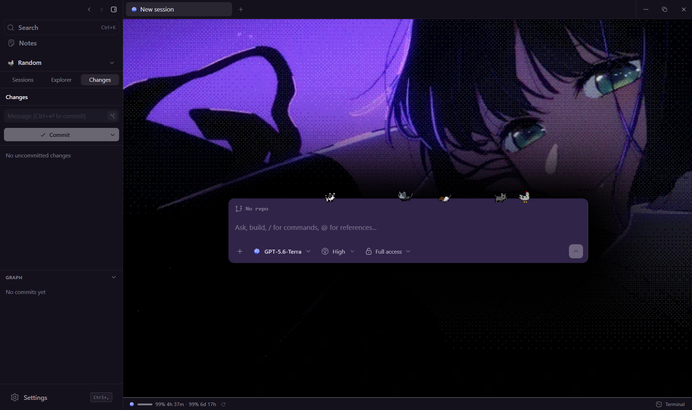

<p align="center">
  
</p>

<h1 align="center">PolyCode</h1>

<p align="center">
  <strong>A Windows desktop UI for your coding agents.</strong>
</p>

> [!NOTE]
> This is my personal modified version of the original **[Monocode](https://github.com/hardbeat920/monocode)**.
> It is maintained and updated **for Windows only** — macOS and Linux builds are **not** updated or supported here. If you are on macOS or Linux, please use the upstream [Monocode](https://github.com/hardbeat920/monocode) repository.

<p align="center">
  
</p>

Works with your subscriptions on Claude Code, Codex, Cursor, Grok Build, OpenCode, Pi, omp, and fx. If they’re installed and logged in, PolyCode can run them. Tabs are sessions. The composer is the input. PolyCode does not sell tokens.

## Prerequisites

Install and log in to at least one supported provider CLI first:

- [Claude Code](https://claude.com/product/claude-code) - `claude auth login`
- [Codex](https://developers.openai.com/codex/cli) - `codex login`
- [Cursor CLI](https://cursor.com/cli) - `agent login`
- [Grok Build](https://docs.x.ai/build/overview) - `grok login`
- [OpenCode](https://opencode.ai) - `opencode auth login`
- [Pi](https://pi.dev/) - `npm install -g @earendil-works/pi-coding-agent`
- [omp](https://omp.sh)
- [fx](https://fx.sh)

## Windows Install

Download the Windows (`x86_64`) NSIS installer from [GitHub Releases](https://github.com/Dreckiez/polycode/releases/latest) (when published) and run it, or build it directly from source below. The installer bootstraps the Microsoft Edge [WebView2](https://developer.microsoft.com/microsoft-edge/webview2/) runtime if it is missing.

> [!IMPORTANT]
> Only **Windows** is targeted and tested in this repository. macOS and Linux are intentionally left unmaintained here.

## Build from source (Windows)

Requires **Node.js 20+** and a current **stable Rust toolchain** (`stable-x86_64-pc-windows-msvc`).

Run in development mode:

```powershell
npm install
npm run tauri dev
```

Build the Windows NSIS installer:

```powershell
npm ci
npm run build:windows
```

The Windows build outputs an NSIS installer under `target/release/bundle/nsis/` and uses `src-tauri/tauri.windows.conf.json`.

## Upstream & License

Based on [Monocode](https://github.com/hardbeat920/monocode) by `hardbeat920`.

Licensed under [MIT](LICENSE). Provider names and logos are trademarks of their owners — see [NOTICE](NOTICE).
